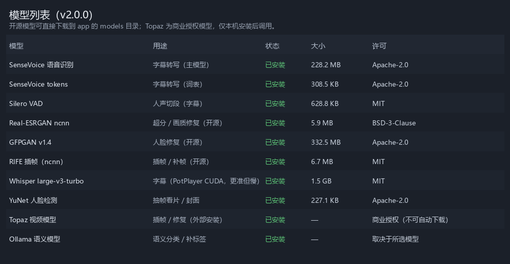

# 更新日志

## 2.0.0 (2026-10-25)

### 新增
- 缩略图刷新支持两个可选增强：
  - **AI选图**：抽帧 → 人脸/清晰度打分 → 以女性为中心裁剪；不达标继续抽帧（最多 36 帧）
  - **提升封面画质**：Real-ESRGAN 2x 处理现有或新建封面，原图备份为 `poster.old.jpg`
- 字幕翻译：勾选后按**系统语言**翻译字幕，另存 `<名>.<语言>.srt`
- 字幕语言新增**西班牙语**（自动使用 Whisper）
- 广告检测支持跳过已检测条目（勾选 force 可重测）
- 番号/目录名尾部 `C`、`CX` 自动识别为烧录字幕（存量已回填）
- 界面标题与模型列表弹窗显示版本号 `v2.0.0`

### 优化
- 封面/截图按**原视频像素**生成，不再固定 640；旧小图自动升级
- 列表徽标：无效段显示 `⛔N`，与广告 `📢N` 对齐
- 「刷新缩略图」默认沿用现有 poster/目录图片，不主动删除重建

### 修复
- 修复 do_POST 路由链断裂（`/api/scan`、`/api/adtect` 等部分接口 404）
- 修复短视频 AI 抽帧因 120s 起点卡住导致失败
- 刷新缩略图操作去掉全部弹窗提示，静默执行

### 已知限制
- Topaz Gigapixel AI 未接入（模型已拷贝，但客户端数据目录/授权未注册）
- AI 选图为 OpenCV 人脸启发式，非大模型语义理解
