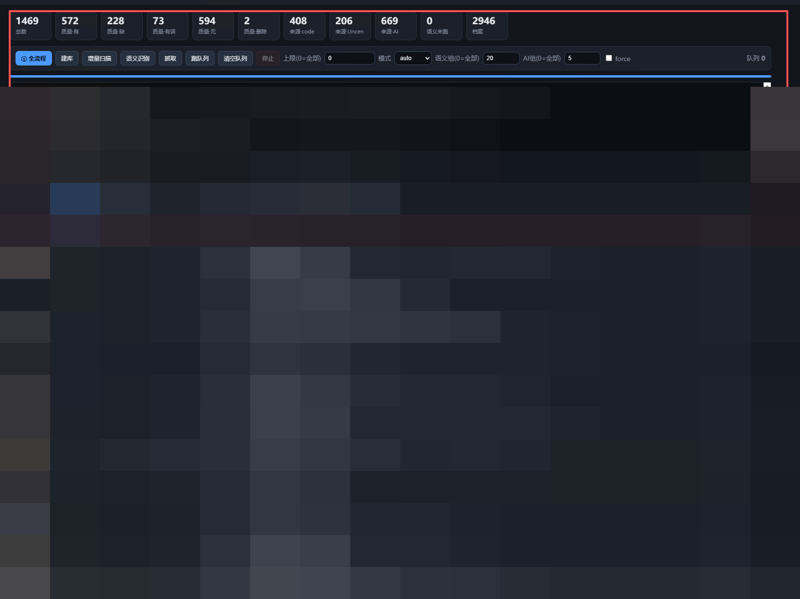
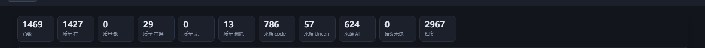
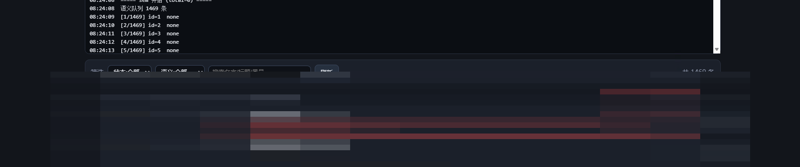
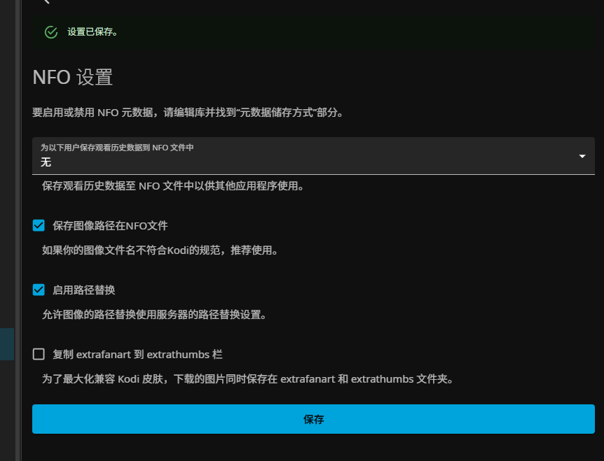

# 卓欣刮削器 · 给你和你的小姐姐

**中文** | [English](README.en.md)

> 本地自托管的一套**成人影片刮削工具**：建库 → 语义识别 → 网站/无码/AI 三线刮削 → 生成 Jellyfin 可用的 NFO 与封面。
> 单文件 HTTP 服务 + SQLite，**不依赖任何云服务**，数据全在本地。

<p align="center">
  <b>建库</b> · <b>语义识别</b> · <b>javbus / javdb / MissAV / 123AV / FC2</b> · <b>本地大模型刮削</b> · <b>AI 看片</b> · <b>封面抽帧</b> · <b>剧集(tvshow)</b> · <b>有误人工复核</b>
</p>

## 界面







<sub>Jellyfin 侧记得打开「保存图像路径在NFO文件」：</sub>



> 以上均为**真实界面截图**（对 1469 条媒体库的实际运行状态，未做任何遮挡）。

---

## ⚠️ 声明（请先读）

- 本项目**仅供个人对本地已合法持有的媒体文件做元数据整理**，不含、不提供、不传播任何影片内容。
- 使用者需**年满 18 周岁**，并自行确保其行为符合**所在国家/地区法律法规**。
- 使用者应自行确认对所刮削的内容拥有合法权利，并自行承担使用后果。
- 项目作者不对任何使用者的行为及其后果负责。
- 本项目**不内置任何爬虫账号、Cookie 或密钥**；JavDB 等站点需你自行提供合法访问凭据。

---

## 目录

- [特性](#特性)
- [环境要求](#环境要求)
- [安装](#安装)
- [启动](#启动)
- [模型支持](#模型支持)
- [配置](#配置)
- [使用](#使用)
  - [流水线](#流水线)
  - [质量 / 来源 / 类型](#质量--来源--类型)
  - [番号与版本后缀](#番号与版本后缀)
  - [界面与操作](#界面与操作)
  - [站点](#站点)
- [目录结构约定](#目录结构约定)
- [数据库](#数据库)
- [常见问题](#常见问题)
- [支持与致谢](#支持与致谢)
- [许可](#许可)

---

## 特性

| | |
|---|---|
| 🗂 **建库/增量扫描** | 扫描媒体库目录树，读取目录自带 `movie.nfo` / `tvshow.nfo` 判定已有状态；支持重建 |
| 🧠 **语义识别** | 本地大模型判断每条是「有码 / 无码 / 无番号」，**20 条一批**一次喂给模型，省往返 |
| 🌐 **网站线** | javbus（有码 **+ `/uncensored` 无码**）→ javdb → MissAV → **123AV**；**并行**于 AI 线 |
| 🎌 **FC2 官方** | FC2-PPV 号直连官网：官方标题 / 样张封面 / 卖家 / 评分 / 价格 |
| 🕵️ **AI 线** | 网站查不到时由本地大模型生成标题/简介/标签，**5 条一批** |
| 🎬 **AI 看片** | 文件名毫无信息（如 `226`、`227`）时：ffmpeg 抽帧 → **视觉模型**看图 → 标题/简介/标签 |
| 🏷 **AI 补全** | 有简介没标签的，按简介批量补标签（选中可强制覆盖旧标签） |
| 🔀 **双线并行** | 网站线（网络 IO）与 AI 线（GPU）同时跑，互不抢资源 |
| 🖼 **封面** | 网站海报 > 目录自带图 > **抽帧**（ffmpeg + OpenCV 人脸/清晰度打分选帧）；**刷新缩略图**可自动"造封面" |
| 🧹 **删除封面图** | 封面文件 + 缩略图缓存一起删，回归"没封面"状态 |
| 📺 **剧集** | 目录下多视频自动识别为剧集，写**单个合并 `tvshow.nfo`**（不按集拆分） |
| 🚧 **内嵌目录检查** | 子目录里还有视频（或 ≥2 个子目录）→ 直接判 `有误`，**不刮**，交人工整理 |
| 🧹 **整理嵌套目录** | 嵌套目录（`kind=nested`）永远进不了自动线 —— 现在一键平铺：图片 `P_`、视频 `V_`，具名目录 `序号_名字_`；**预览 + 确认弹框 + 一键回滚**，未识别类型的文件不动、其子目录也不清理 |
| 🔌 **端口 / 局域网** | 界面直接改**监听端口**、开关**局域网访问**，**即时热切换**，无需重启 |
| ✏️ **质量/来源/语义** | 表格内**双击直接改**，选中后**顶部统一批量操作** |
| 🔃 **列表排序** | 排序字段 **编号（默认）/ 入库时间 / 最后编辑** × **正序 / 倒序**，随筛选一起记住（localStorage）；id 列悬停显示入库与最后编辑时间 |
| 🚨 **有误人工复核** | 网站两条线都没抓到 / 目录嵌套 → `有误`，跳过自动刮削，交人工 + 大模型处理（见 [`有误处理提示词.md`](有误处理提示词.md)） |
| 📇 **番号参考表** | 从库内数据自动统计的常用番号前缀表，见 [`番号参考表.md`](番号参考表.md) |
| 💾 **全落库** | 队列、日志、配置全部持久化（SQLite WAL），重启不丢 |

---

## 🐳 Docker 部署（推荐：NAS / 不想装环境）

一条命令起来，**不用装 Python、不用配 ffmpeg**：

```bash
docker run -d --name zhuoyue-scraper \
  -p 8811:8800 \
  -e MS_ROOT=/media \
  -e MS_DB=/data \
  -e MS_OLLAMA=http://host.docker.internal:11434 \
  -e PUID=1000 -e PGID=1000 \
  -v /你的媒体库:/media \
  -v ./zhuoyue-data:/data \
  --add-host host.docker.internal:host-gateway \
  --restart unless-stopped \
  ghcr.io/ceiling0518/zhuoyue-scraper:latest
```

打开 `http://<主机IP>:8811`。

或用 **compose**（推荐）：把 `docker-compose.yml` 里的媒体库路径改成你的，然后：

```bash
docker compose up -d
```

支持 **linux/amd64 与 linux/arm64**（群晖/威联通 ARM 机型可直接跑）。

### 环境变量

| 变量 | 默认 | 说明 |
|---|---|---|
| `MS_ROOT` | `/media` | 媒体库根目录（容器内路径） |
| `MS_DB` | `/data` | 数据库/缓存/缩略图目录（**必须持久化**） |
| `MS_OLLAMA` | `http://host.docker.internal:11434` | Ollama 地址（可指向局域网另一台机器） |
| `MS_HOST` / `MS_PORT` | `0.0.0.0` / `8800` | 监听地址与端口（容器内） |
| `PUID` / `PGID` | `0` | 以哪个身份写文件；**建议填媒体目录的属主**，否则写出的 .nfo 会属 root |
| `MS_JAVDB` | 空 | javdb 镜像域名（被地区封锁时用） |

### ❗ 没有 Ollama 也能用

**主链完全不依赖 Ollama**：扫描目录 → 识别番号 → 多站点刮削 → 写 `.nfo` + 封面缩略图 → 队列与日志。

| 功能 | 无 Ollama | 有 Ollama |
|---|---|---|
| 扫描 / 识别番号 / 建库 | ✅ | ✅ |
| 网站刮削（JavBus/MissAV/avsox/123AV/NJAV/Netflav/JAVTrailers/FC2） | ✅ | ✅ |
| 写 `.nfo` / 封面 / 缩略图 / 剧集合并 | ✅ | ✅ |
| 语义分类（有码/无码/无） | ❌ | ✅ |
| AI 看片（文件名无信息时抽帧识片） | ❌ | ✅ |
| AI 标签补全 | ❌ | ✅ |
| 网站都查不到时的 AI 兜底 | ❌ | ✅ |

> 所以 **ARM NAS 用户（一般没有 Ollama）同样值得装** —— 拿到的是“纯刮削”这条主链，
> 对 Jellyfin/Emby 来说这已经是完整可用的元数据。

### 容器里的行为差异（自动降级）

- 「**打开目录**」「**本机打开大图**」在容器内**自动隐藏**（服务端没有桌面）
- 「**删除**」= **永久删除**（容器/Linux 无回收站），界面保留红色警告
- 端口/局域网热切换照常用，但容器内通常直接用 `-p` 映射

### 自己构建

```bash
docker build -t zhuoyue-scraper:latest .
# 国内加速：
docker build --build-arg PIP_INDEX_URL=https://你的pip镜像/simple -t zhuoyue-scraper:latest .
```

---

## 环境要求

| 组件 | 说明 |
|---|---|
| **Python** | 3.10+（开发环境 3.14） |
| **ollama** | 本地大模型运行时，**必须用 `ollama serve` 启动**（托盘版读不到 `OLLAMA_MODELS`） |
| **ffmpeg / ffprobe** | 在 PATH 中，抽帧、取时长、AI 看片用 |
| **操作系统** | Windows（回收站删除、资源管理器打开为 Windows 实现；其余平台可自行适配） |

Python 依赖：

```bash
pip install requests opencv-python numpy zhconv
```

---

## 安装

```bash
git clone https://github.com/ceiling0518/zhuoyue-scraper.git
cd zhuoyue-scraper
pip install requests opencv-python numpy zhconv
```

确认 ollama 已就绪：

```bash
ollama serve                # 另开一个终端常驻
ollama list                 # 应能看到你的模型
```

---

## 启动

```bash
python app.py
```

或双击 `run.cmd`。浏览器打开：

```
http://127.0.0.1:8800/
```

- **改端口 / 开局域网**：界面顶部直接改「端口」、勾「局域网」，点**保存设置** —— **即时生效**（内部热切换监听），不需要重启。
- 开启局域网后会列出可访问地址，例如 `http://192.168.1.100:8800/`。
- 也可以用环境变量（优先级高于界面设置）：`set MS_HOST=0.0.0.0`、`set MS_PORT=8801`。

---

## 模型支持

### 〇、界面语言与输出语言

- **界面语言**：顶部下拉，支持 **中文 / English / 日本語 / Español / 繁體中文** 五种。切换后刷新页面即生效。
- **元数据输出语言**：与界面语言**相互独立**（顶部「输出语言」，默认「跟随界面」）。它决定写入 `.nfo` 的**标题 / 简介 / 标签**用哪种语言 —— 比如你可以用英文界面，但让元数据保持**日文原文**（片名日文最准），或者反过来。

### 〇·5、站点体检

「站点设置」里两个按钮：

- **检测连通性**：快速请求各站入口 → `通过 / 不通过(原因)`。原因分类：`geo-block`（代理落地地区被封锁）、`cloudflare?`（人机验证，仅提示）、`spa-shell`（首页小，SPA 正常，仅提示）、`origin-down`（源站挂，如 522）、`timeout`。
- **深度自检**：**用固定试号真抓一次**，回报 `命中 <番号> · N 字段 · 耗时` —— 这才是「能不能用」的最终判据。

实测（2026-10-12）：**javbus / MissAV / avsox / 123AV / NJAV / Netflav / JAVTrailers / FC2 官方 共 8 站可用**；
`javdb` 返回 geo-block —— **需换代理落地地区，或设环境变量 `MS_JAVDB` 指向可用镜像**；
`jav321` 源站 522（已禁用）。

### 一、语言模型（语义识别 + AI 刮削 + AI 补全）

本项目的**语义识别**与**AI 刮削**通过 [ollama](https://ollama.com) 调用，**任何 ollama 模型都可以**——只要它能按提示词稳定输出 JSON。界面顶部可下拉切换。

已验证 / 推荐：

| 模型 | 参数量 | 用途 | 备注 |
|---|---|---|---|
| `qwen38-27b-uncen` | 27B | **默认**：语义 + AI 刮削 + **AI 看片** | 中文强，无审查微调，标签质量最好 |
| `qwen38-27b-q4` | 27B (Q4) | 同上 | 24GB 显存可跑 |
| `qwopus38-27b-q4` | 27B (Q4) | 备用 | |
| `muse-glimmer:30b-q4_K_M` | 30B (Q4) | 备用 | |
| `opus-distill-q5` | — | 备用 | |
| `qwen38-9b-v2` | 9B | 低显存 | 快，质量略降 |

> **AI 看片**需要一个**带 `vision` 能力**的模型（`ollama show <模型>` 可看能力列表）。上表 27B 系列都支持。
> 提示：模型必须**不拒答**（成人题材会被安全对齐模型大量拒绝），因此推荐使用社区无审查微调版。

### 二、封面 / 抓图

| 组件 | 用途 |
|---|---|
| **ffmpeg / ffprobe** | 抽帧、读取视频时长、AI 看片取样帧 |
| **OpenCV（含 YuNet DNN 人脸检测）** | 抽帧自动选帧打分：人脸数、清晰度、色彩度、肤色比例、亮度、构图 |
| **javbus / javdb / MissAV / 123AV / FC2 官方** | 海报下载 |

**封面取值优先级**：网站抓到的海报 → 目录自带的图 → 抽帧。

- **抽帧取帧时间规则**：剧集且 `时长 / 3 > 120` → 从 **120 秒之后**取帧；其余情况**不限定**取帧时间。
- **刷新缩略图**：没封面会**自动造一张** —— 目录里有图就选最大的那张，连图都没有就**从视频里截一帧**，写成 `poster.jpg`。
- **删除封面图**：`poster.*` / `fanart.*` / `folder.jpg` + 应用缓存副本 + 缩略图缓存，一次清干净。

---

## 配置

界面顶部「保存设置」写入数据库（`config` 表）：

| 项 | 说明 |
|---|---|
| **媒体库位置** | 媒体库根目录（支持 UNC 网络路径，如 `\\NAS\share\movie`） |
| **模型** | 当前使用的 ollama 模型 |
| **端口** | 监听端口（默认 `8800`），改完**即时生效** |
| **局域网** | 勾选 = 监听 `0.0.0.0`（同网段可访问）；不勾 = 只听 `127.0.0.1` |

环境变量（优先级高于界面设置）：

| 变量 | 默认 | 说明 |
|---|---|---|
| `MS_HOST` | `127.0.0.1` | 监听地址（设了就以它为准） |
| `MS_PORT` | `8800` | 监听端口（设了就以它为准） |
| `OLLAMA_MODELS` | — | ollama 模型目录（`ollama serve` 启动时读取） |
| `FFMPEG` / `FFPROBE` | `ffmpeg` / `ffprobe` | 可指定完整路径 |
| `JAV_PROXY` | `http://127.0.0.1:7897` | 抓取站点用的 HTTP 代理 |

界面按钮参数：

| 参数 | 含义 | 0 的含义 |
|---|---|---|
| **上限** | 本次运行处理总条数 | **全部** |
| **语义组** | 语义识别每批喂给模型的条数 | **全部一批**（内部单批上限 60 自动切分） |
| **AI组** | AI 刮削每批喂给模型的条数 | **全部一批**（同上） |
| **模式** | `auto` / `ai` / `website` | — |
| **force** | 忽略质量，强制重刮 | — |

---

## 使用

### 流水线

```
建库(scan) → 语义识别 → 抓取（网站线 ∥ AI 线）
```

- 语义识别决定路线：`coded` / `uncensored` → 网站线；`none` → AI 线
- 两条线**并行**执行；网站线失败 → 标记 `有误`
- 选中条目后可用顶部操作栏批量重跑
- **刮削前会先做内嵌目录检查**：子目录里还有视频 → 直接 `有误`，不浪费模型调用

### 质量 / 来源 / 类型

**质量 quality**

| 值 | 含义 | 行为 |
|---|---|---|
| `有` | 信息完整（标题 + 简介 + 标签） | **跳过所有刮削** |
| `缺` | ① 有标题+简介但**没有标签**（MissAV 天生没标签；AI 来源同理）② **文件名没用**（纯数字如 `226`，只能等 AI 看片） | 默认完成；可用 **AI 补全 / AI 看片** 补齐 |
| `无` | 有数据但标题没洗干净（= 原始文件夹名），或还没有可用数据 | **正常开展刮削** |
| `有误` | ① **网站两条线都没抓到** ② **目录嵌套**（内嵌目录有视频，或 ≥2 个内嵌目录） | **跳过**，交人工 + 大模型处理 |
| `删除` | 已删除；或扫描发现目录已不存在 | 默认列表**不显示**，可单独筛选 |

**来源 source**：`code`（javbus/javdb）· `Uncen`（MissAV/123AV）· `AI`（本地模型）

**类型 kind**

| 值 | 判定 | 处理 |
|---|---|---|
| `single` | 1 个视频 | 普通电影流 |
| `series` | 多个视频（剧-集，平铺） | 自动刮削，写**一个合并 `tvshow.nfo`** |
| `nested` | 子目录里还有视频（多重嵌套） | 判 `有误`，人工调目录后重跑 |
| `novideo` | 目录里没视频 | 不处理 |

> ⚠️ kind 以**磁盘实际结构**为准：写入 NFO 时会自动纠正库里的过期值（目录整理过之后不用手动改）。

### 番号与版本后缀

番号格式：

```
  <系列代号> - <编号> [ - <版本后缀> ]
  例：ABP-123        例：SSIS-001-HD        例：MIDA-456-C
```

**版本后缀**（末尾字母，只描述"这一份拷贝的版本"，**不参与番号匹配**）：

| 后缀 | 含义 |
|---|---|
| `C` | 中文字幕 |
| `J` / `X` | 破解版 |
| `HD` | 高画质 |
| `SD` | 低画质 |
| `4K` | 4K 画质 |

> 搜站前会自动剥掉后缀：`ABP-123-HD` → 用 `ABP-123` 去搜。
> **常用番号前缀表**（从库内数据统计）见 [`番号参考表.md`](番号参考表.md)。

### 界面与操作

**顶部**：媒体库位置 · 模型选择 · **端口** · **局域网** · 保存设置 · 说明 · JavDB Cookie · 站点

**按钮**：① 全流程 · 建库（**二次确认**）② 增量扫描 · 语义识别 · 抓取 · 跑队列 · 清空队列 · 停止

**顶部统一操作栏**（作用于选中的条目）

| 操作 | 说明 |
|---|---|
| 重跑·网站 | 只跑**网站线**（javbus / javdb / MissAV / 123AV / FC2） |
| 重跑·AI | 只跑 **AI 线**（本地模型，按文件名） |
| **AI 补全** | 按**简介**批量补标签（选中时允许覆盖旧标签） |
| **AI 看片** | **抽帧看视频**生成标题/简介/标签（文件名没信息时用） |
| 重跑·全流程 | 网站线 + AI 线 |
| 重跑队列 | 按右侧下拉（auto / website / ai）压入后台队列（**持久化**，重启不丢） |
| 打开目录 | 打开选中条目的文件夹（**显式置前**） |
| 刷新缩略图 | 没封面就**造**一张（选图 / 从视频截帧）→ 清缩略图 → 重建 |
| 删除封面图 | 删封面文件 + 缩略图缓存 |
| 删除 | 目录 + 视频删除到回收站（**两步确认**）；目录已不存在时也能把库内记录归档删掉 |
| 全选本页 / 取消选择 | 批量选中 |

> ⚠️ **媒体库在 NAS（UNC 网络路径）上时，Windows 无法真正进入回收站，实际等于永久删除**（确认框内有警告）。

**选择**：每行右侧一个「选择」按钮 —— 点一下选中（**整行高亮**），再点取消。

**表内直接改**：**双击**单元格即可修改

| 列 | 编辑方式 |
|---|---|
| 质量 | 下拉 有 / 缺 / 有误 / 无 / 删除 |
| 来源 | 下拉 code / Uncen / AI |
| 语义 | 下拉 coded / uncensored / none |
| 番号 | 文本框 |

修改「语义 / 番号」会自动置 `sem_manual=1`（语义阶段不再覆盖人工值）。回车确认，Esc 取消。

**筛选**：质量 / 来源 / 语义 / 搜索（默认不含「删除」）
**分页**：底部「上一页 / 第 N / M 页（下拉）/ 下一页」；**刷新后保持当前页与筛选**。
**缩略图**：小图（160px，缓存在 `thumbs/`，不占数据库）；点击 = 用本机看图器打开目录里**最大的原图**。
**JavDB Cookie**：顶部按钮，可**粘贴**或**选文件上传**，保存后写入 `javdb_cookie.txt`，JavDB 抓取立即生效。
**站点设置**：顶部「站点」按钮
- 列出全部源站（见下）
- **勾选**要用的站点（抓取时按此顺序尝试）
- 「**检测连通性**」→ 逐个发**真实请求**（与抓取器同一会话/重试/代理），显示 状态码 + 延迟
- 抓取统一走本地代理 `JAV_PROXY`（默认 `http://127.0.0.1:7897`）

### 站点

| 站点 | 类型 | 状态 |
|---|---|---|
| JavBus | 有码 **+ 无码**（`/uncensored`） | ✅ 已接入 |
| JavDB | 有码（全字段：片商/类型/演员/日期/时长） | ✅ 已接入（需 Cookie） |
| MissAV | 无码 | ✅ 已接入 |
| **123AV** | 无码 | ✅ 已接入（标题/封面/时长/类型） |
| **FC2 官方** | FC2 | ✅ 已接入（官方标题/样张/卖家/评分/价格） |
| JAV321 | 有码 | ⏳ 源站 522，暂不可用 |
| avsox | 无码 | ⏳ SPA，需接口 |
| NJAV | 无码 | ⏳ 123AV 镜像，需接口 |
| Netflav | 聚合 | ⏳ SPA（`__NEXT_DATA__`） |
| JavTrailers | 资料 | ⏳ SPA（`__NUXT__`） |

> 无码号在 JavBus **只认数字部分**（`1pondo-012817_473` → 搜 `012817_473`），代码里会自动生成变体重试。

---

## 目录结构约定

```
媒体库根/
├── 单视频条目/             → single
│   ├── xxx.mp4
│   ├── movie.nfo          (本工具生成)
│   └── poster.jpg
├── 多视频条目/             → series（剧-集）
│   ├── 1.mp4  2.mp4  3.mp4
│   └── tvshow.nfo         (本工具生成的合并 NFO)
└── 带子目录的条目/          → nested（多重嵌套）
    └── 子目录/
        └── xxx.mp4
```

NFO 中**写入图片路径**（`<thumb>` / `<fanart>`），对应 Jellyfin 的「保存图像路径在NFO文件」。

---

## 数据库

SQLite（`mlib.db`，WAL 模式）：

| 表 | 用途 |
|---|---|
| `items` | 主表：path / name / code / quality / source / kind / title / plot / tags / actors / studio / year / sem_kind / sem_code / sem_manual / cover / nfo / present … |
| `archive` | 归档：建库重建、目录消失、删除的记录 |
| `queue` | 重跑队列（持久化） |
| `joblog` | 任务日志（持久化，保留最近 3000 行） |
| `config` | 设置：`root`（媒体库位置）、`model`（模型）、`port`（端口）、`lan`（局域网） |
| `runs` | 每次扫描的增/减记录 |

---

## 常见问题

**Q：ollama 明明有模型，界面却说「看不见模型」？**
A：托盘版 `ollama app.exe` 读不到 `OLLAMA_MODELS`。请改用 **`ollama serve`** 启动。

**Q：MissAV 抓到的条目没有标签？**
A：MissAV 本身不提供标签。这类条目判 `缺`（默认完成，不再重刮），后期可用 **AI 补全** 补标签。

**Q：为什么有些条目一直是 `无`？**
A：`无` = 有数据但标题没洗干净（等于原文件夹名）。若某条网站线始终找不到，请改判 `有误` 或人工填写。

**Q：条目名是 `226` / `227` 这种，怎么办？**
A：这类判 `缺`，意思是"文件名没有信息，只能靠 AI 看片"。选中后点 **AI 看片**，让它抽帧看图生成。

**Q：`有误` 是什么情况？**
A：目前就两种 —— ① 网站两条线都没搜到；② 目录嵌套（子目录里还有视频）。**刮削前会先检查内嵌目录**，命中就直接判 `有误`，不做无用的模型调用。

**Q：改端口/开局域网要重启吗？**
A：不用。保存后**即时热切换**（正在处理的请求不会断），界面会打印可访问地址。

**Q：局域网里别人打不开？**
A：确认勾了「局域网」；再检查 Windows 防火墙是否放行该端口（首次监听 `0.0.0.0` 时可能弹出放行提示）。

**Q：剧集在 Jellyfin 里没被识别成一季？**
A：本工具只负责写 `tvshow.nfo`，**分集命名 / 季目录**（`剧名 S01E01.mp4`）需要你自行调整。目录结构不对的会在建库时判 `有误`。

**Q：封面没生成？**
A：抽帧要求视频可解码；`<2 分钟` 的单视频会按规则跳过。可用「刷新缩略图」自动造一张，或「打开目录」确认目录里有没有图。

**Q：删除会进回收站吗？**
A：媒体库在 **NAS / 网络路径**上时，Windows 无法回收，等于**永久删除**。

---

## 支持与致谢

- 语言模型：[ollama](https://ollama.com) 及社区无审查微调模型作者
- 人脸检测：[OpenCV](https://opencv.org) YuNet
- 元数据来源：[javbus](https://www.javbus.com) · [javdb](https://javdb.com) · [MissAV](https://missav.ws) · [123AV](https://123av.com) · [FC2 官方](https://adult.contents.fc2.com)
- 媒体服务器：[Jellyfin](https://jellyfin.org)

问题 / 建议：请开 Issue。**请勿在 Issue 中粘贴任何 Cookie、密钥或影片内容截图。**

---

## 许可

MIT License

Copyright (c) 2026 ceiling0518

> 再次提醒：请在**遵守当地法律**的前提下使用本项目；一切后果由使用者自行承担。
